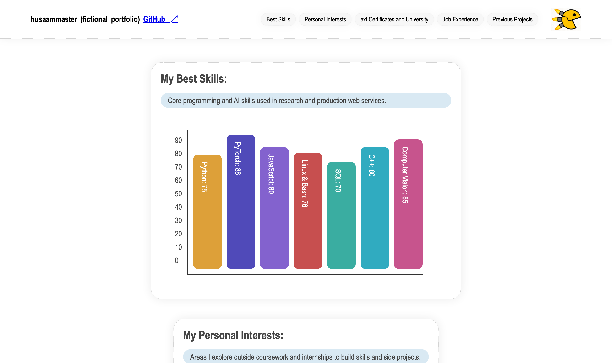
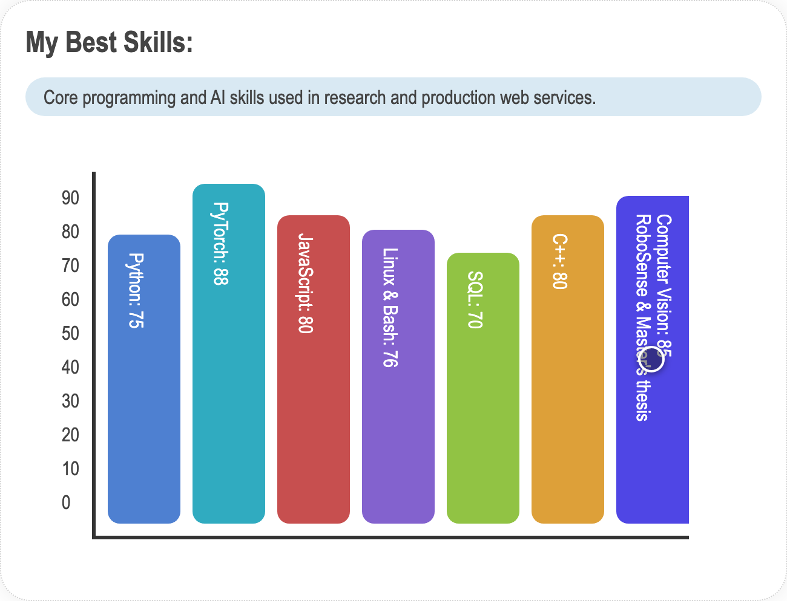
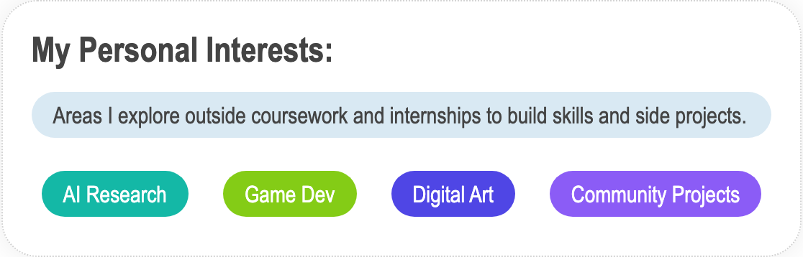
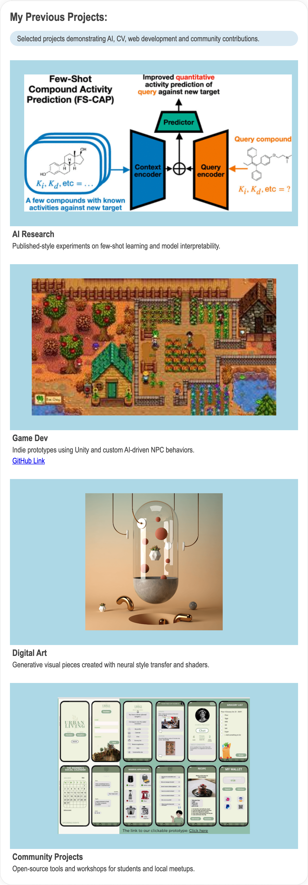
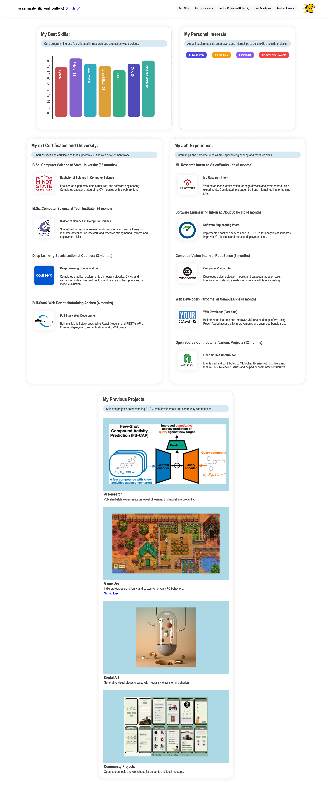
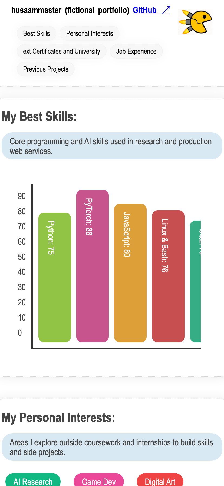

# fictional_portfolio — Galerie

Eine ausführliche Tour durch das Projekt. `fictional_portfolio` ist eine
**interaktive Portfolio-Seite in reinem Vanilla JavaScript** – kein Framework,
kein Build-Schritt. Der komplette Inhalt wird zur Laufzeit aus einer JSON-Datei
aufgebaut, und als verspielte Ebene darüber liegt ein kleines „Raketen“-Spiel mit
eigener Physik. Sämtliche Inhalte sind fiktive Demo-Daten.

---

## Datengetriebenes Rendering ✅

Die Seite ist leer im HTML – alles entsteht aus `assets/data.json`. Pro Kapitel
bestimmt das Feld `type`, welcher Renderer benutzt wird (`value-bars`, `badges`,
`logo-markdown-flex`, `slider-grid`). So lassen sich Inhalte und Darstellung
allein über die JSON steuern. Geladen wird per `XMLHttpRequest`.

---

## Skills als animiertes Balkendiagramm ✅

Die Balken skalieren auf den jeweiligen Wert und bekommen zufällige Farben. Beim
Überfahren verbreitert sich ein Balken und blendet die zugehörige Projektnotiz ein
(hier: „Computer Vision“ mit „RoboSense & Master's thesis“).

---

## Badges & Markdown-Blöcke ✅

Interessensgebiete erscheinen als farbige Badges. Zertifikate und Berufserfahrung
werden als Logo-+-Text-Blöcke dargestellt, deren Beschreibung mit `marked.js` aus
Markdown gerendert wird.

---

## Projekt-Slider ✅

Jedes Projekt ist eine Karte mit einem Medien-Slider, der per Klick und automatisch
(alle 15–19 s) weiterschaltet. Unterstützt werden Bilder, Videos (`.mp4`) und
GitHub-Badges (Sterne/Forks via shields.io).

---

## Das Raketen-System ✅

Ein Klick auf das Pacman-Icon im Header spawnt vier Raketen. Jede folgt der Maus
mit echter Physik (Beschleunigung, Dämpfung, Maximalgeschwindigkeit, gelegentliche
Zufallslenkung) und dreht sich in Flugrichtung.

**Spawn:**

<video src="https://github.com/husaammaster/fictional_portfolio/raw/main/docs/gallery/rockets-spawn.mp4" controls autoplay loop muted playsinline width="760"></video>

**Effekte beim Überfliegen** – Raketen lösen je nach Typ unterschiedliche Effekte
auf den überflogenen Elementen aus (Wackeln, Entsättigen, Rotation, Verdunkeln):

<video src="https://github.com/husaammaster/fictional_portfolio/raw/main/docs/gallery/rockets-effects.mp4" controls autoplay loop muted playsinline width="760"></video>

**Treffer / Zerstören** – ein Klick auf eine Rakete löst eine Explosions-Animation
aus (der rote Ring zeigt den Mausklick):

<video src="https://github.com/husaammaster/fictional_portfolio/raw/main/docs/gallery/rockets-hit.mp4" controls autoplay loop muted playsinline width="760"></video>

**Reparatur-Menü** – der Rechtsklick ist umgemünzt: Statt des Browser-Menüs
erscheint ein eigenes Menü, das zerstörte Raketen auflistet und per Klick wieder
repariert (die Rakete erwacht oben links neu zum Leben):

<video src="https://github.com/husaammaster/fictional_portfolio/raw/main/docs/gallery/rockets-repair.mp4" controls autoplay loop muted playsinline width="760"></video>

---

## Responsives Layout ✅

Auf breiten Screens liegen die Kapitel im Flex-Wrap-Raster nebeneinander; auf dem
Smartphone stapeln sie sich, und der Header bricht sauber um.

| Breit | Mobil |
|-------|-------|
|  |  |

---

*Medien in `docs/gallery/` wurden automatisch aus der laufenden Seite aufgenommen
(Playwright + ffmpeg), inklusive sichtbarem Mauszeiger und Klick-Visualisierung.*
